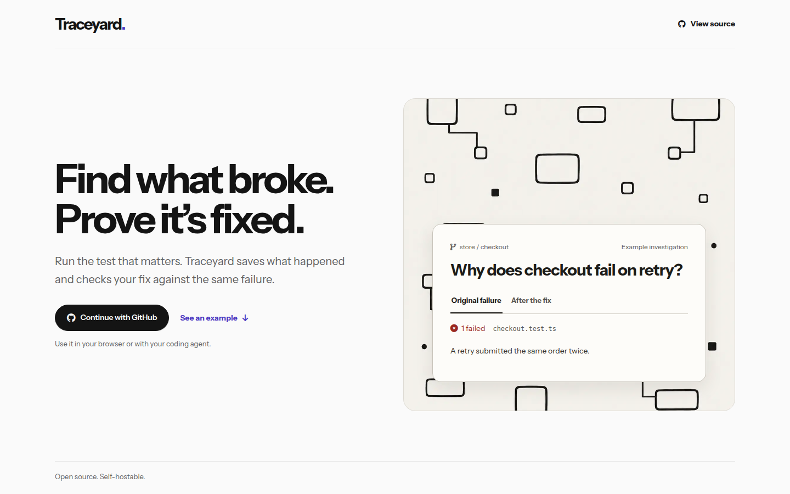

# Traceyard

Traceyard runs the test that shows what broke and checks your fix against it.

A failed test can get buried in CI logs. By the time a fix is ready, it’s easy to lose track of which test failed and what commit it ran on. Traceyard keeps that first failure beside the rerun so you and your coding agent can work from the same evidence.

## Quickstart

1. Open [Traceyard](https://traceyard.pilotsaviour229.workers.dev). **See an example** works without an account.
2. Sign in with GitHub and connect a repository. To run tests, enable the reviewed GitHub Actions workflow from **Connections**.
3. In **Investigations**, describe the failure and pick an existing test. Focused execution supports npm projects that run Vitest or Jest.
4. Push your fix and choose **Verify a repair** on the result. Enter the new commit SHA to rerun the original test.

You can also connect an agent over MCP. Sign in first, then grant the agent project access when you need it. [Connect a coding agent](docs/MCP.md)

## More

[Repository setup](docs/REPOSITORY_SETUP.md) · [Self-hosting](docs/PRODUCTION_RELEASE.md) · [Contributing](CONTRIBUTING.md) · [Changelog](CHANGELOG.md) · [MIT license](LICENSE)
